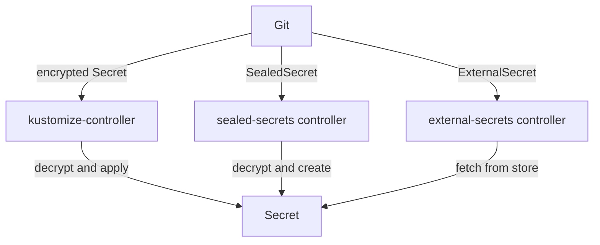

# The Options For Secrets In GitOps

A Secret cannot go to Git in plain text, but Git should still describe everything the cluster runs. GitOps teams solve this in one of two ways: they put the Secret in Git **encrypted**, or they put only a **reference** to a value that lives in a secret store. This part compares the three tools that most Flux users choose from, so you can tell which one a team uses and why.

## Encrypt the value in Git: SOPS

SOPS is a command-line tool that encrypts the values in a YAML or JSON file and leaves the keys and the structure readable. A Secret encrypted with SOPS still shows `kind: Secret`, its name and its namespace in Git, so a review can see what changed. Only the values under `data` or `stringData` turn into encrypted text.

SOPS encrypts for one or more keys: an age key, a PGP key, or a key in a key management service (KMS) such as AWS KMS, Google Cloud KMS, Azure Key Vault or HashiCorp Vault. Flux has SOPS built in. kustomize-controller decrypts the file just before it applies it, with a key you give it in a Kubernetes Secret, or with access to the KMS. No extra controller runs in the cluster.

## Encrypt for one cluster: Sealed Secrets

Sealed Secrets is a controller that you install in the cluster. It creates its own key pair and publishes the public key. You encrypt a Secret with that public key, using the `kubeseal` tool, and commit the result as a `SealedSecret` object. The controller in the cluster is the only thing that can decrypt it, and it creates the real Secret.

The repository holds only encrypted values, as with SOPS, but the key belongs to one controller in one cluster. A `SealedSecret` for one cluster cannot be read by another, and nobody can decrypt it outside the cluster, not even the author.

## Keep a reference in Git: External Secrets Operator

External Secrets Operator is a controller that copies values from an external secret store into Kubernetes Secrets. The store can be AWS Secrets Manager, Google Secret Manager, Azure Key Vault, HashiCorp Vault and many others. Git holds an `ExternalSecret` object that says which value to fetch and which Secret to create; it never holds the value itself, encrypted or not.

The value lives and is rotated in the store. The controller reads it again on an interval and updates the Secret, so a rotation does not need a commit at all.

The diagram shows the three paths from Git to a Secret: SOPS is decrypted by Flux itself, a `SealedSecret` by its own controller, and an `ExternalSecret` is filled from a secret store.

## Choosing between them

All three keep plain values out of Git; they differ in where the key or the value lives and in who can read it. The table puts the differences side by side:

| | SOPS with Flux | Sealed Secrets | External Secrets Operator |
| --- | --- | --- | --- |
| What is in Git | The Secret, values encrypted | A `SealedSecret`, values encrypted | An `ExternalSecret`, no value |
| Where the key or value lives | An age or PGP key, or a KMS | The controller's key pair in the cluster | The external secret store |
| Extra controller | None, kustomize-controller decrypts | The sealed-secrets controller | The external-secrets controller |
| Who can decrypt outside the cluster | Everyone with the key or KMS access | Nobody | Everyone with access to the store |
| Rotating a value | Encrypt the new value and commit | Seal the new value and commit | Change it in the store; no commit |
| Fits best | Teams that want Git to hold everything, and one key for many clusters | One cluster, authors who never need to read values back | Organisations that already run a secret store |

SOPS is the option this course builds on, because Flux supports it without any extra software and because it shows each step clearly: you encrypt, you commit, and Flux decrypts. Sealed Secrets and External Secrets Operator both work with Flux too, since Flux applies their objects like any other.

You now know the three ways to keep a secret out of Git in plain text, and what each one stores where. The question that remains comes first in every real repository: what to do with the Secret that is already committed in plain text.

## Common pitfalls

> [!WARNING]
> - **Thinking an encrypted Secret in Git needs no rotation plan.** Whoever holds the key reads every version in history. When a key leaks, every value it protected must change.
> - **Mixing up the tools' objects.** Flux applies a `SealedSecret` or an `ExternalSecret` like any object; a different controller turns it into a Secret. Flux's own decryption only works on SOPS files.
> - **Expecting Sealed Secrets to move between clusters.** A `SealedSecret` is encrypted for one controller's key. Another cluster cannot decrypt it.
> - **Forgetting where the value really lives with External Secrets Operator.** Git and the cluster only hold references and copies; the secret store is the source of truth for the value.
