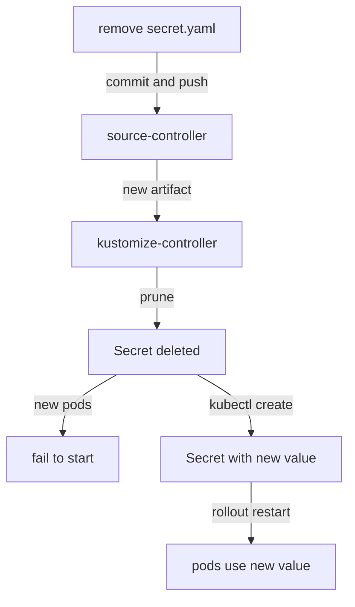

# Removing A Secret That Was Committed

The Secret `podinfo-db` is in Git, so its password is known. Two things must happen: the Secret must leave Git, and the password must change. The order matters, because Flux applied that Secret and Flux prunes what leaves Git. This part removes the Secret, watches what Flux does, and puts a new value in place while `podinfo` keeps serving.

## What Flux does when a Secret leaves Git

The Flux `Kustomization` `podinfo` has `prune: true`. kustomize-controller keeps a list of every object it applied, called the inventory, in `.status.inventory`. On each run it compares that list with what the folder in Git builds now. An object that is in the list but no longer in Git is deleted.

Look at the inventory before you change anything:

<!-- astrona:playground:renew -->

```sh
kubectl -n flux-system get kustomization podinfo \
  -o jsonpath='{range .status.inventory.entries[*]}{.id}{"\n"}{end}'
```

Each line is one object, written as namespace, name, API group and kind joined by underscores. One line names the Secret `podinfo-db` in the namespace `podinfo` with the kind `Secret` and an empty group. As long as that line is there, the Secret comes from Git, and kustomize-controller will delete it once it leaves Git.



The diagram shows the sequence this part follows: the commit leads to the Secret being pruned, and the new value is created outside Git before `podinfo` restarts.

## Take the Secret out of Git

A Kustomize file `kustomization.yaml` in `apps/podinfo` lists the files kustomize-controller builds. Remove `secret.yaml` from that list, then delete the file. Save this as `fleet/apps/podinfo/kustomization.yaml`:

```yaml
apiVersion: kustomize.config.k8s.io/v1beta1
kind: Kustomization
resources:
  - namespace.yaml
  - deployment.yaml
  - service.yaml
```

Then delete the Secret file, commit and push. The port-forward must still be running:

```sh
cd fleet
git rm apps/podinfo/secret.yaml
git commit -am "Remove the plain podinfo-db Secret"
git push
cd ..
```

Flux would notice the commit within a minute. Ask it to fetch and apply now, and then look for the Secret:

```sh
flux reconcile kustomization podinfo --with-source
kubectl -n podinfo get secret podinfo-db
```

The reconcile finishes with the new revision applied, and `kubectl` answers that the Secret `podinfo-db` is not found. kustomize-controller pruned it. The `podinfo` pods that are already running keep working, because their environment variable was set when they started. A new pod, for example after a restart or a node failure, cannot start: the kubelet cannot find the Secret it needs, and the pod waits with a `CreateContainerConfigError` status.

## Put a new value in place

The old password is known, so the new Secret gets a new value. For now it is created outside Git, with `kubectl`, so that the value never reaches the repository:

```sh
kubectl -n podinfo create secret generic podinfo-db --from-literal=password=a-new-password
kubectl -n podinfo rollout restart deployment/podinfo
kubectl -n podinfo rollout status deployment/podinfo
```

The rollout finishes with every new pod ready, and the new pods read the new password. Run the inventory command from the start of this part again: the Secret is no longer listed. kustomize-controller does not manage this Secret, so it never prunes or overwrites it. A Secret created by hand is a gap in GitOps, because Git no longer describes it; an encrypted Secret in Git closes that gap again.

If deleting the Secret even for a few seconds is not acceptable, there is a gentler order. First commit the annotation `kustomize.toolkit.fluxcd.io/prune: disabled` on the Secret, so kustomize-controller leaves it in the cluster when it leaves Git. Then remove the file in a second commit, and change the value with `kubectl`. The old value is still known either way, so the rotation is never optional.

You can now take a committed Secret out of Git, predict that Flux prunes it, and replace it with a new value outside Git. The open question is how to put that new value back into Git without exposing it again.

## Common pitfalls

> [!WARNING]
> - **Creating the new Secret before Flux prunes the old one.** If the object is still in the inventory, the next reconciliation that no longer finds it in Git deletes it, including your new value. Wait for the prune, or use the `prune: disabled` annotation first.
> - **Removing the file but not the line in `kustomization.yaml`.** The Kustomize build then fails on a missing file, and the Flux `Kustomization` stops applying anything.
> - **Keeping the old value.** The old password is in Git history. Rotate it.
> - **Committing the new value "just for now".** Every commit is permanent. Create it outside Git until it can be committed encrypted.

## Your mission: Remove A Plain Secret From Git

You can now remove a committed Secret, let Flux prune it, and put a new value in place outside Git. The graded lab gives you the repository with the Secret `podinfo-db` committed in plain text, and asks you to take it out of Git, give it a new password, and keep `podinfo` running.

The lab runs in its own cluster, so first pause your playground. Nothing in it is lost:

```sh
astrona stop ats-097-playground-010-01
```

Then start the lab:

```sh
astrona run --git ssh://git@github.com/astrona-io/ATS097.git -c sections/section-010/module-01/labs/lab-01
```

The task is on the next page. Solve it on your own first. When you think you are done, send it for grading:

```sh
astrona submit -c sections/section-010/module-01/labs/lab-01
```

When the lab is done, remove it and start your playground again:

```sh
astrona destroy ats-097-lab-010-01
astrona start ats-097-playground-010-01
```
