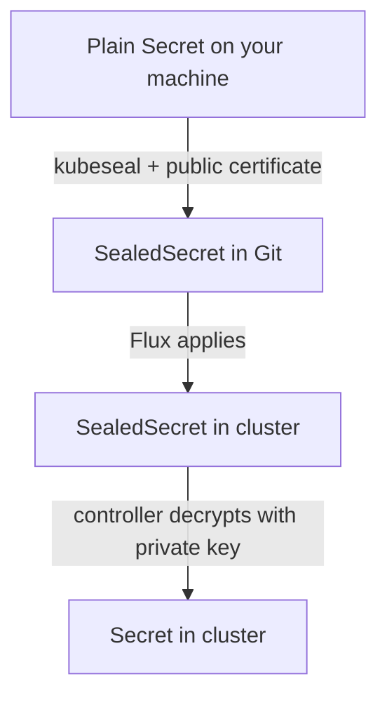

# How Sealed Secrets Works

A plain Secret cannot go to Git, and the encryption has to come from somewhere. With Sealed Secrets the cluster produces the key, and the person who writes a Secret needs only the public half. This part explains the parts and the flow, and why the design gives a property that SOPS does not have by default: the encrypted file is useless on any other cluster.

## The parts

The controller runs in the cluster, by default in `kube-system`. At first start it generates an RSA key pair and stores it as a Secret in its own namespace. The public half is a certificate that the controller serves; the private half never leaves the cluster.

`kubeseal` is the command-line tool. It reads a Secret manifest, takes the controller's certificate, and writes a `SealedSecret` manifest in which each value of the Secret is encrypted. It needs the certificate and nothing else. You can fetch the certificate once and seal offline afterwards.

The `SealedSecret` is a custom resource with the API `bitnami.com/v1alpha1`. Its `spec.encryptedData` holds one encrypted value per key. Its `spec.template` can describe the Secret to create, such as its type or labels.

## The flow

The diagram shows that Flux applies an encrypted object and the controller makes the Secret. Flux needs no key.

The controller watches `SealedSecret` objects. For each one it decrypts the values, creates a Secret with the same name and namespace, and sets itself as the owner of that Secret. If you delete the `SealedSecret`, Kubernetes garbage collection deletes the Secret it owns. If the Secret changes by hand, the controller replaces it with the content of the `SealedSecret`.

## Why the encrypted file is bound to one cluster

The values are encrypted with the controller's public key, and only its private key can decrypt them. Another cluster has another key pair, so a `SealedSecret` copied there cannot be decrypted. That limits the damage of a leaked file, and it also means you seal once per cluster, not once for all.

You can now describe the controller, `kubeseal` and the `SealedSecret`, and follow a Secret from your machine to the cluster. The next part does it with a real controller.

## Common pitfalls

> [!WARNING]
> - **Thinking Flux decrypts a SealedSecret.** Flux only applies it. The controller decrypts.
> - **Committing the plain Secret next to the SealedSecret.** The plain file defeats the encryption. Keep it outside the repository.
> - **Expecting one SealedSecret to work on every cluster.** Each cluster has its own key pair.
