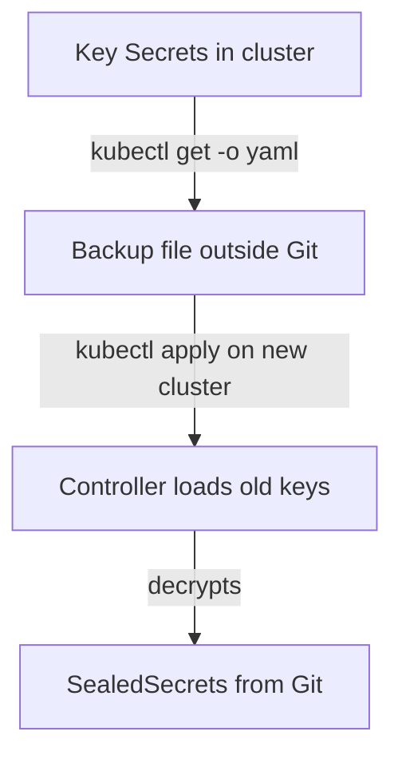

# The Controller Key: Rotation And Backup

The private key of the controller is the only thing that can open your sealed files. If the cluster is lost and the key is not saved, every `SealedSecret` in Git becomes unreadable. If the key leaks, everything sealed with it is exposed. This part covers how the controller renews keys, how to back them up and restore them, and how Sealed Secrets compares with SOPS.

## Where the keys are

The controller stores each key pair as a Secret in its own namespace, with the label `sealedsecrets.bitnami.com/sealed-secrets-key`. List them:

<!-- astrona:playground:renew -->

```sh
kubectl -n flux-system get secrets -l sealedsecrets.bitnami.com/sealed-secrets-key
```

The newest key has the value `active` in that label. Older keys stay in the list so that the controller can still decrypt older `SealedSecret` objects.

## Renewal

By default, the controller creates a new key every 30 days and uses it for new sealing. The old keys remain, so nothing breaks. A renewal changes the certificate that `kubeseal --fetch-cert` returns, so refresh any copy you committed. Existing files do not change. To move a `SealedSecret` to the newest key, use `kubeseal --re-encrypt`, which asks the controller to re-encrypt the file. This does not make an old key harmless: anyone with the old private key could still decrypt old files in Git history.

## Back up and restore

Save all the key Secrets to a file and store the file outside the cluster and outside Git, in a place with its own access control:

```sh
kubectl -n flux-system get secrets -l sealedsecrets.bitnami.com/sealed-secrets-key -o yaml > sealed-secrets-keys.yaml
```

To restore on a new cluster, apply that file before you install the controller, or apply it and restart the controller. The controller then loads the existing keys and decrypts the `SealedSecret` objects in Git without any re-sealing.



The diagram shows the backup and restore loop. Without the backup file, the last step cannot happen.

## Sealed Secrets or SOPS

Sealed Secrets keeps the private key inside the cluster and needs no setup on the Flux side. Each file works for one cluster. SOPS keeps the private key where you choose, supports several clusters and key services, and encrypts any file, not only Secrets, but Flux needs the identity and the decryption setting. Choose Sealed Secrets for simple, single-cluster setups with Secrets only. Choose SOPS when one repository serves many clusters, when you need a KMS, or when you encrypt files that are not Secrets.

You can now explain the key lifecycle, back up and restore the keys, and choose between the two tools. The summary closes the module.

## Common pitfalls

> [!WARNING]
> - **Having no backup of the key Secrets.** A lost cluster means lost secrets.
> - **Storing the backup file in Git.** It holds the private keys in plain form.
> - **Assuming renewal protects old files.** It only changes the key for new sealing.
> - **Forgetting to refresh the committed certificate.** New files are sealed with an old key, which still works but delays rotation.
