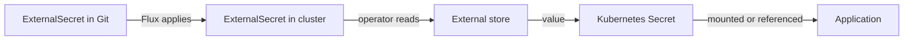

# How The External Secrets Operator Works

The operator is a controller that reads from a secret store and writes Kubernetes Secrets. It has no key that decrypts files in Git. It has credentials to the store, and those credentials are the thing you protect. This part explains the resources and the loop that keeps the Secret in sync.

## The resources

A `SecretStore` is namespaced. It names a provider, such as AWS Secrets Manager, Google Secret Manager, Azure Key Vault or Vault, and the way to authenticate to it. A `ClusterSecretStore` is the same but cluster-wide, so `ExternalSecret` objects in any namespace can use it.

An `ExternalSecret` is namespaced. It names a store in `spec.secretStoreRef`, the values to read in `spec.data` or `spec.dataFrom`, and the Secret to produce in `spec.target`.

The API group is `external-secrets.io`. The current version of these resources is `v1`.

## The loop

The diagram shows that the value never passes through Git. The operator reads the store, writes the Secret, and repeats at the refresh interval, so a change in the store reaches the cluster without a commit.

## What this changes

The secret has one source of truth, the store, with its own audit log, access control and rotation. A rotation in the store reaches every cluster that reads it. The cost is a runtime dependency: if the store is unreachable, new Secrets cannot be created, though existing Secrets stay in place. And the operator needs credentials to the store, which must reach the cluster some other way.

You can now describe the three resources and the loop. The next part runs it.

## Common pitfalls

> [!WARNING]
> - **Committing the store credentials to Git in plain form.** The operator needs them, but they are a secret too. Seal or encrypt them, or use workload identity.
> - **Using a `ClusterSecretStore` everywhere.** Any namespace can then read any value the store allows.
> - **Expecting a Git change to change the value.** The value changes in the store.
