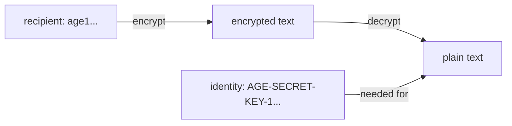

# age Keys And Recipients

Before SOPS can encrypt anything, it needs a key to encrypt for. This part creates an age key pair on your machine and shows what each half does. Getting the two halves straight matters more than any command that follows: one half you may paste anywhere, the other must never leave a safe place.

## Create a key pair

age is a small encryption tool with its own simple key format. An age key pair has two halves. The **recipient** is the public key; it starts with `age1`, and anyone who has it can encrypt for you. The **identity** is the private key; it starts with `AGE-SECRET-KEY-1`, and only it can decrypt.

`age-keygen` creates a new pair and writes it to a file. Create one outside the folder where you will clone the repository, so it can never be committed by accident:

<!-- astrona:playground:renew -->

```sh
mkdir -p ~/age-keys
age-keygen -o ~/age-keys/age.agekey
```

The command prints one line, `Public key:` followed by a recipient that starts with `age1`. The file holds a comment with the creation time, a comment with the same public key, and one line that starts with `AGE-SECRET-KEY-1`. That last line is the identity. The file name ends in `.agekey` on purpose: Flux looks for that ending when it reads an age identity from a Kubernetes Secret.

You do not need to copy the recipient from the screen. `age-keygen -y` reads an identity and prints its recipient, so the identity file is all you need to keep:

```sh
age-keygen -y ~/age-keys/age.agekey
```

The output is the same `age1` recipient. The opposite direction is impossible: nothing turns a recipient back into its identity, which is why the recipient is safe to share.

## Encrypt with the recipient, decrypt with the identity

The two halves have opposite jobs, and SOPS uses them the same way age does on its own. Try it with a short message before you encrypt a Secret:

```sh
RECIPIENT="$(age-keygen -y ~/age-keys/age.agekey)"
printf 'hello from age\n' | age -r "$RECIPIENT" -a > message.age
cat message.age
age -d -i ~/age-keys/age.agekey message.age
```

`age -r` encrypts for one recipient, and `-a` writes the result as text, so `cat` shows a block that starts with `-----BEGIN AGE ENCRYPTED FILE-----`. `age -d -i` decrypts with the identity and prints `hello from age` again. The person who encrypted needed only your recipient; the person who decrypts needs your identity.



The diagram shows the split: the recipient is enough to encrypt, and only the identity turns the encrypted text back into plain text.

## Where each half belongs

A team usually shares one recipient for a repository, or one per environment, and commits it in the SOPS configuration file. The identity lives where something must decrypt: in the cluster, as a Kubernetes Secret that kustomize-controller reads, and in a password manager for the people who edit encrypted files. It never goes to Git, not even encrypted for itself.

| Half | Starts with | Safe to commit? | Where it lives |
| --- | --- | --- | --- |
| Recipient | `age1` | Yes | `.sops.yaml` in the repository |
| Identity | `AGE-SECRET-KEY-1` | Never | A Kubernetes Secret in the cluster, a password manager |

A file can be encrypted for several recipients at once, for example one key for the cluster and one for the on-call team. Each recipient's identity can then decrypt it on its own.

You now have a key pair, you know which half encrypts and which decrypts, and where each belongs. The question that remains is how SOPS uses the recipient to encrypt only the values of a Kubernetes Secret.

## Common pitfalls

> [!WARNING]
> - **Creating the key inside the repository folder.** One `git add .` commits it. Keep identities outside the clone, and add `*.agekey` to `.gitignore` as a second guard.
> - **Mixing up the halves.** The `age1` recipient goes into configuration; the `AGE-SECRET-KEY-1` identity never does.
> - **Keeping only the printed public key.** Without the identity file, nobody can decrypt. Back the identity up before you encrypt anything that matters.
> - **Naming the identity file without `.agekey`.** Flux only reads Secret keys that end in `.agekey` as age identities.
