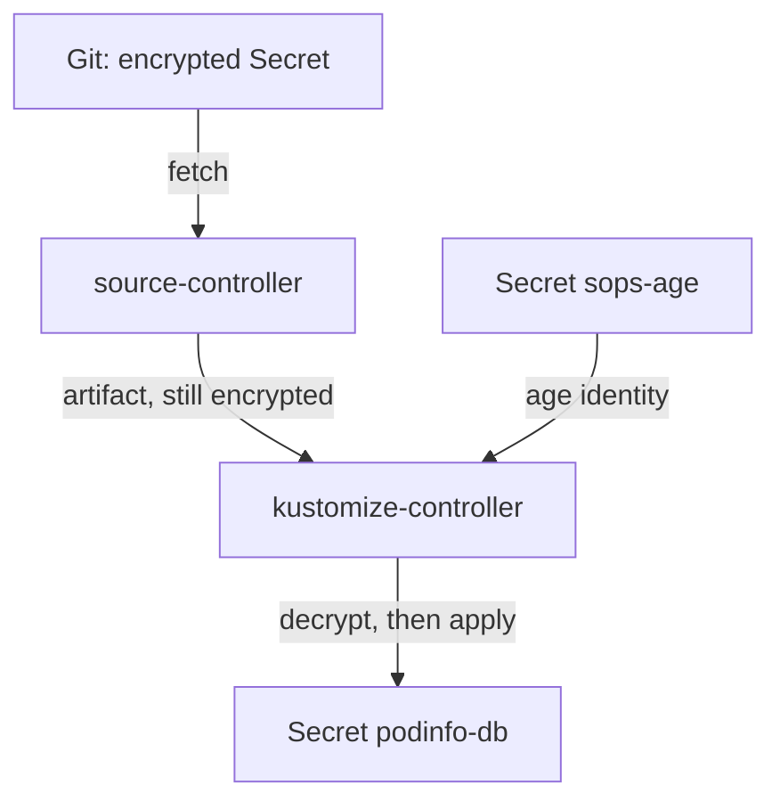

# Decryption In kustomize-controller

An encrypted Secret in Git is only useful if something in the cluster can decrypt it at the right moment. In Flux, that is kustomize-controller, and the moment is just before it applies the objects of a Flux `Kustomization`. This part starts from a cluster where that does not happen, finds out why, and turns decryption on.

## Where decryption happens

source-controller fetches the repository and stores it as an artifact, exactly as Git holds it: the Secret is still encrypted in the artifact. kustomize-controller downloads the artifact and builds the path of the Flux `Kustomization`. When the Flux `Kustomization` has `spec.decryption.provider: sops`, kustomize-controller then decrypts every SOPS-encrypted value it finds, with the keys in the Kubernetes Secret named in `spec.decryption.secretRef`. Only after that does it apply the objects.



The diagram shows that the plain value appears only inside kustomize-controller and in the Secret it creates; Git and the artifact keep the encrypted text.

## See what happens without a key

The playground's Flux `Kustomization` `podinfo` has no decryption settings. Look at its state and its recent events:

<!-- astrona:playground:renew -->

```sh
flux get kustomizations
flux events --for Kustomization/podinfo
```

The Flux `Kustomization` `podinfo` is not `Ready`. Read the message and the events: they name the Secret `podinfo-db` and the problem with it, because kustomize-controller was asked to apply a file that still holds SOPS metadata and encrypted values. Then look at the application:

```sh
kubectl -n podinfo get secret podinfo-db
kubectl -n podinfo get pods
```

There is no usable Secret `podinfo-db` with the real password, and the `podinfo` pods wait in `CreateContainerConfigError`, because their environment variable `DB_PASSWORD` needs that Secret. The fix is not in Git: the file is correct. The cluster is missing the key and the instruction to use it.

## Give kustomize-controller the identity

kustomize-controller reads age identities from a Kubernetes Secret in the same namespace as the Flux `Kustomization`, here `flux-system`. Each key of that Secret whose name ends in `.agekey` is read as an age identity. In this playground the team's identity sits in the Secret `team-age-key` in `gitea`; copy it to a file outside any repository, then create the Secret `sops-age` from it:

```sh
mkdir -p "$HOME/age-keys"
kubectl -n gitea get secret team-age-key -o jsonpath='{.data.age\.agekey}' | base64 -d > "$HOME/age-keys/team.agekey"
kubectl -n flux-system create secret generic sops-age --from-file=age.agekey="$HOME/age-keys/team.agekey"
```

The Secret `sops-age` now holds one key, `age.agekey`. `--from-file=age.agekey=...` sets the key name explicitly; the name of the file on your disk does not matter.

## Turn on decryption

Now tell the Flux `Kustomization` to decrypt with that Secret. Save this as `kustomization-podinfo.yaml`:

```yaml
apiVersion: kustomize.toolkit.fluxcd.io/v1
kind: Kustomization
metadata:
  name: podinfo
  namespace: flux-system
spec:
  interval: 10m
  sourceRef:
    kind: GitRepository
    name: fleet
  path: ./apps/podinfo
  prune: true
  timeout: 3m
  decryption:
    provider: sops
    secretRef:
      name: sops-age
```

Apply it:

```sh
kubectl apply -f kustomization-podinfo.yaml
```

Then check the result:

```sh
flux reconcile kustomization podinfo
kubectl -n podinfo get secret podinfo-db -o jsonpath='{.data.password}' | base64 -d; echo
kubectl -n podinfo get pods
```

The Flux `Kustomization` becomes `Ready`, the Secret `podinfo-db` holds the decrypted password `decrypted-by-flux`, and the `podinfo` pods start. In Git the file is still encrypted; open it in a clone of `gitops/fleet` to confirm.

You can now read why an encrypted Secret does not reach the cluster, give kustomize-controller an age identity, and turn on decryption. The open question is how to change that identity later without a moment where nothing can decrypt.

## Common pitfalls

> [!WARNING]
> - **Naming the key in `sops-age` without `.agekey`.** kustomize-controller does not read it as an age identity, and decryption still fails.
> - **Creating `sops-age` in the wrong namespace.** `spec.decryption.secretRef` looks in the namespace of the Flux `Kustomization`, here `flux-system`.
> - **Committing the identity to make decryption work.** The identity belongs in the cluster only. Committed, it decrypts every Secret in the repository for everyone.
> - **Giving the cluster a different key than the file was encrypted for.** The recipient in the file's `sops:` block must match an identity in `sops-age`. Check with `age-keygen -y`.

## Your mission: Make Flux Decrypt Secrets

You can now give kustomize-controller an age identity and turn on SOPS decryption for a Flux `Kustomization`. The graded lab gives you a cluster where an encrypted Secret in Git does not reach `podinfo`, and asks you to make Flux decrypt it without changing the file in Git.

The lab runs in its own cluster, so first pause your playground. Nothing in it is lost:

```sh
astrona stop ats-097-playground-020-02
```

Then start the lab:

```sh
astrona run --git ssh://git@github.com/astrona-io/ATS097.git -c sections/section-020/module-02/labs/lab-01
```

The task is on the next page. Solve it on your own first. When you think you are done, send it for grading:

```sh
astrona submit -c sections/section-020/module-02/labs/lab-01
```

When the lab is done, remove it and start your playground again:

```sh
astrona destroy ats-097-lab-020-02
astrona start ats-097-playground-020-02
```
