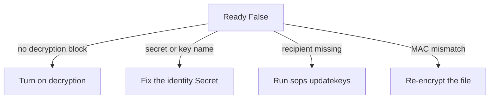

# Troubleshooting Decryption Failures

A Flux `Kustomization` that decrypts SOPS files depends on three things being right at the same time: the setting on the Kustomization, the identity in the cluster and the recipients in the file. When one is wrong, the Kustomization stops and the Secret does not reach the cluster. This part shows where kustomize-controller reports the failure and how to tell the four common causes apart.

## Where the failure is reported

kustomize-controller writes the result of every reconcile into the `Ready` condition of the Flux `Kustomization`, and into Kubernetes events. Start with the condition, because its message names the step that failed:

<!-- astrona:playground:renew -->

```sh
flux get kustomizations
kubectl -n flux-system get kustomization podinfo -o jsonpath='{.status.conditions[?(@.type=="Ready")].message}{"\n"}'
flux events --for Kustomization/podinfo
```

When decryption fails, the message mentions the decryption step and SOPS, and `Ready` is `False`. The objects that were already in the cluster stay as they are, because the Kustomization applies nothing from a build that failed. For the full text of the controller's own error, read its log:

```sh
kubectl -n flux-system logs deploy/kustomize-controller --tail=30
```

## The four causes

The message and the setup together point to one of four causes. Check them in this order, because each one is cheaper to test than the next.

1. **Decryption is not turned on.** The Kustomization has no `spec.decryption`, so the encrypted file is applied as it is. The apply may even succeed with a Secret whose values are encrypted text, so the application fails later. Read `spec.decryption` with `kubectl -n flux-system get kustomization podinfo -o yaml`.
2. **The identity Secret is missing or has a wrong key name.** `spec.decryption.secretRef.name` must name a Secret in the same namespace as the Kustomization, and its data key must end in `.agekey` for age. A key named `age.key` or `identity.txt` is ignored. List the keys with `kubectl -n flux-system get secret sops-age -o jsonpath='{.data}' | jq 'keys'`.
3. **The identity does not match any recipient.** The file lists recipients in its `sops:` block. Print them with `grep recipient` on the file, and print the public key of the identity with `age-keygen -y` on your copy of the key. If the public key is not in the list, SOPS cannot decrypt the data key.
4. **The file was changed after encryption.** SOPS stores a message authentication code (MAC) of all the values in the `sops:` block and checks it at decryption. Editing an encrypted value by hand makes the check fail. Re-encrypt the file from the plain source, or edit it with `sops` itself.



The diagram maps each message to its fix. After the fix, ask for a reconcile instead of waiting for the interval:

```sh
flux reconcile kustomization podinfo --with-source
```

`--with-source` fetches the `GitRepository` first, so a file you just pushed is part of the build.

## Test decryption on your machine first

You can reproduce causes 3 and 4 without the cluster. SOPS reads the identity from the environment variable `SOPS_AGE_KEY_FILE`. Point it at your copy of the identity and decrypt the file you pushed:

```sh
SOPS_AGE_KEY_FILE=age.agekey sops --decrypt apps/podinfo/secret.yaml
```

If SOPS decrypts on your machine with the same identity that is in the cluster, the file and the key are fine, and the fault is in the cluster settings. If it fails with the same identity, the file is the fault.

You now know where kustomize-controller reports a decryption failure and how to separate the four causes. What remains is a precise picture of what the decryption settings accept, which is the next topic.

## Common pitfalls

> [!WARNING]
> - **Running `kubectl apply -f` on the encrypted file to test it.** That applies the encrypted text as the Secret's values. Test with `sops --decrypt` and let Flux apply.
> - **Fixing the Secret in the cluster by hand.** The Kustomization and Git are the source of truth, and the next reconcile removes your change.
> - **Assuming a green `GitRepository` means the Secret arrived.** The source can be ready while the Kustomization fails at decryption. Check both.
