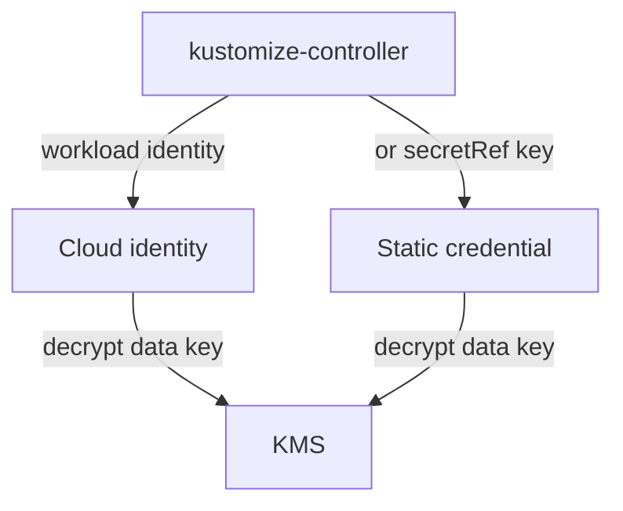

# Cloud KMS And Vault With Flux

The `.sops.yaml` rule names the key, and the cluster must prove it is allowed to use it. There are two ways to give kustomize-controller that right: an identity that the cloud ties to the controller's service account, or a static credential stored in the same Secret as other decryption keys. This part shows the rule for each service and the two ways to authenticate.

## The creation rules

The rules differ only in the field and the value. Save the one you need as `.sops.yaml`; the identifiers are examples:

<!-- astrona:playground:renew -->

```yaml
creation_rules:
  - path_regex: secrets/aws/.*\.yaml$
    encrypted_regex: ^(data|stringData)$
    kms: arn:aws:kms:eu-west-1:111122223333:key/1234abcd-12ab-34cd-56ef-1234567890ab
  - path_regex: secrets/gcp/.*\.yaml$
    encrypted_regex: ^(data|stringData)$
    gcp_kms: projects/my-project/locations/global/keyRings/flux/cryptoKeys/sops
  - path_regex: secrets/azure/.*\.yaml$
    encrypted_regex: ^(data|stringData)$
    azure_keyvault: https://my-vault.vault.azure.net/keys/sops-key/0123456789abcdef
  - path_regex: secrets/vault/.*\.yaml$
    encrypted_regex: ^(data|stringData)$
    hc_vault_transit: https://vault.example.com:8200/v1/sops/keys/flux
```

Each rule applies to its own folder. A real repository would normally use only the one service that its cloud provides. Nothing in the file is secret: ARNs and URLs identify keys but do not grant access.

## Workload identity

The preferred way to authenticate uses the platform's identity for pods. On AWS, a role for service accounts lets the pod of kustomize-controller assume an IAM role with permission to use the key. On Google Cloud and Azure, workload identity does the same with a Google service account or an Azure managed identity. In each case you annotate the Kubernetes service account that the controller runs as, grant that cloud identity permission to decrypt with the key, and set nothing in the Flux `Kustomization` except `decryption.provider: sops`.

When different Kustomizations need different cloud identities, for example one per tenant, set `spec.decryption.serviceAccountName` to a service account in the Kustomization's namespace. kustomize-controller then uses the cloud identity bound to that service account, and a tenant can only decrypt what its own identity allows.

## Static credentials

Where workload identity is not available, store the credential in the Secret named by `spec.decryption.secretRef`, under the key name for the service:

| Service | Key in the Secret |
| --- | --- |
| AWS KMS | `sops.aws-kms` |
| Google Cloud KMS | `sops.gcp-kms` |
| Azure Key Vault | `sops.azure-kv` |
| HashiCorp Vault | `sops.vault-token` |

The Flux documentation gives the format of each value, which is the content of the provider's usual credential file or token. A static credential is a secret that must itself be kept out of Git and rotated, so it brings back the problem that a KMS was meant to remove. Use it only when you must.



The diagram shows that both ways end at the same call to the key service. They differ in where the proof of identity comes from.

You can now write the rule for each service and describe the two ways to give the controller access. The playground has no cloud account, so the next part uses PGP to practise the whole flow with a key you create.

## Common pitfalls

> [!WARNING]
> - **Granting `encrypt` and `decrypt` to everyone in the account.** Give the controller `decrypt` only, and give people who write secrets `encrypt`.
> - **Using one cloud identity for every tenant.** A tenant could then decrypt every other tenant's files.
> - **Keeping a static credential in Git.** It is a secret like any other. Encrypt it or avoid it.
