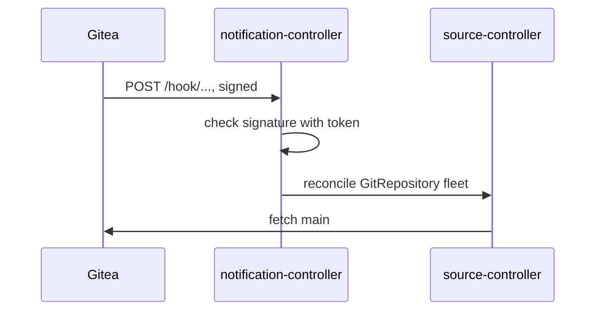

# Polling, Webhooks And The Receiver API

Every Flux source has an interval, and that interval decides how long a change waits in Git before the cluster sees it. This part measures that wait in the playground, then introduces the object that removes it: the `Receiver`. It covers what a Receiver listens for, what it reconciles, and how it makes sure a request really comes from your Git server.

## The cost of polling

source-controller fetches the branch of a `GitRepository` once per interval. The playground's `GitRepository` `fleet` uses one hour. Look at it and at the revision it holds:

<!-- astrona:playground:renew -->

```sh
kubectl -n flux-system get gitrepository fleet -o jsonpath='{.spec.interval}{"\n"}'
flux get sources git
```

The interval is `1h`, and the revision is the commit source-controller fetched when the playground started. A commit pushed now stays invisible to the cluster until the next fetch, up to an hour later. You could lower the interval to one minute, but then source-controller asks the Git server sixty times an hour, mostly to learn that nothing changed, and a large organisation multiplies that by every repository and every cluster.

A webhook removes the trade-off. The Git server sends one HTTP request when a push happens, and the cluster fetches once, at the right moment. The interval stays as a safety net for webhooks that are lost.

## What a Receiver is

A `Receiver` is a Flux object, API `notification.toolkit.fluxcd.io/v1`, that notification-controller reconciles. notification-controller serves every Receiver through one Kubernetes Service, `webhook-receiver`, in `flux-system`. Look at it:

```sh
kubectl -n flux-system get service webhook-receiver
```

The Service exists as soon as Flux is installed; it routes requests to notification-controller. Note the port in the `PORT(S)` column: the webhook addresses on these pages use port `80`. If your cluster shows a different port, add it to the addresses.

A Receiver has four fields that matter:

| Field | What it does |
| --- | --- |
| `spec.type` | Which kind of sender to expect and how to check its requests: `generic`, `generic-hmac`, `github`, `gitlab`, `bitbucket`, `harbor`, `dockerhub`, `quay`, `nexus`, `acr`, `gcr`, `generic-oidc`, `cdevents` |
| `spec.events` | Which event types to act on, for example `push`; empty means all |
| `spec.secretRef` | A Secret with the key `token`, a random string shared with the sender |
| `spec.resources` | The Flux objects to reconcile when a valid request arrives, by `kind` and `name` (or `name: "*"` with `matchLabels`) |

There is no `gitea` type. Gitea sends webhooks in the same format as GitHub, with the same headers, so a Receiver for Gitea uses the type `github`.

## The webhook path and the token

When a Receiver is ready, notification-controller writes its address into `.status.webhookPath`. The path is `/hook/` followed by a SHA-256 hash of the token, the Receiver's name and its namespace. Nobody can guess it without the token, and it changes when the token changes. The full webhook address is the Service plus that path, for example `http://webhook-receiver.flux-system.svc.cluster.local/hook/` followed by the hash.



The diagram shows one push: Gitea calls the webhook path, notification-controller checks the request, and asks source-controller to fetch now.

A secret path alone is not enough protection, because paths end up in logs. The `github` and `generic-hmac` types also check a signature. The sender computes a hash-based message authentication code (HMAC) of the request body with the shared token and sends it in a header; for the `github` type that is `X-Hub-Signature-256` or `X-Hub-Signature`, for `generic-hmac` it is `X-Signature`. notification-controller computes the same HMAC with the token from `spec.secretRef` and rejects the request if they differ. The `generic` type checks nothing beyond the path, so use it only where nothing else is possible.

You now know why polling is slow, what a Receiver is made of, and how its path and signature keep strangers from triggering reconciliations. The open question is how to connect a real Git server to it.

## Common pitfalls

> [!WARNING]
> - **Lowering the interval instead of adding a webhook.** It works, at the cost of constant requests to the Git server. Keep a long interval as a safety net and let the webhook trigger.
> - **Looking for a `gitea` type.** Gitea uses the `github` type, because it sends GitHub-compatible webhooks.
> - **Using the `generic` type with a public address.** Anyone who learns the path can trigger reconciliations. Prefer a type that checks a signature.
> - **Forgetting that a new token means a new path.** After you change the token, read `.status.webhookPath` again and update the sender.
