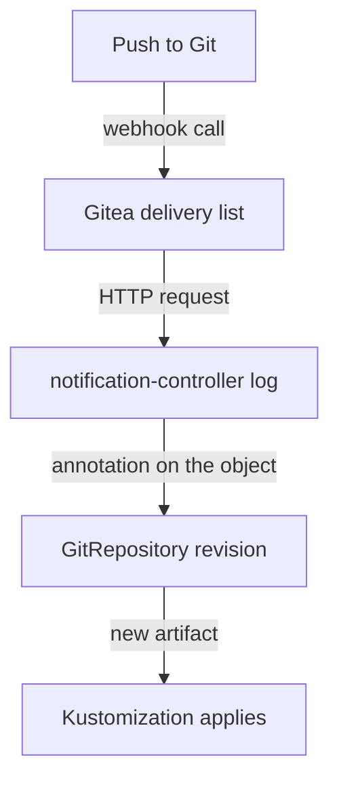

# Reading Receiver Status And Troubleshooting Delivery

A webhook fails silently from the point of view of the person who pushed: the commit is in Git, and the cluster does not change. Three systems take part in every delivery, the Git server, the network between it and the cluster, and notification-controller, so a fault can sit in any of them. This part shows where each one records what it saw, so you find the broken link in a few commands instead of guessing.

## What a ready Receiver tells you

notification-controller reconciles a `Receiver` and records the result in `.status`. The `Ready` condition says whether the Receiver is valid, and `.status.webhookPath` holds the path it serves. Read both:

<!-- astrona:playground:renew -->

```sh
flux get receivers
kubectl -n flux-system get receiver gitea-receiver -o jsonpath='{.status.conditions[?(@.type=="Ready")].message}{"\n"}{.status.webhookPath}{"\n"}'
```

A Receiver that is not `Ready` has no usable path. The message names the reason, for example that the Secret named in `spec.secretRef` does not exist or has no `token` key. Fix that before you look at anything else, because no request can succeed against a Receiver that is not ready.

## Follow one delivery

A delivery has three records. The Git server keeps the first: Gitea lists each webhook call with its response code under the repository's webhook settings. The second is the notification-controller log, which records the requests it accepted and the objects it asked to reconcile. The third is the object that was reconciled: source-controller changes the revision of the `GitRepository` only when it fetched a new commit.

Read the notification-controller log and the events of the `GitRepository`:

```sh
kubectl -n flux-system logs deploy/notification-controller --tail=20
flux events --for GitRepository/fleet
```

If the log shows a request for your Receiver and the `GitRepository` events show a new revision, the webhook works and the fault is in what happens after the fetch, which belongs to kustomize-controller. If the log shows no request at all, the Git server never reached the Receiver, and the Gitea delivery list tells you why.



The diagram shows the four places to look, from the sender to the result. Check them in this order and stop at the first one that does not show the push.

## The usual faults

Each fault leaves a different mark, so the mark tells you the fix:

- The Gitea delivery shows a connection error. The address is wrong: the Service name, the namespace or the port. Call the address from the `tester` pod with `curl` to confirm.
- The Gitea delivery shows an error response and the log names an invalid request. The signature does not match, so the token in Gitea and the token in the Secret differ.
- The Gitea delivery succeeds, but the revision does not change. The Receiver accepted the request and reconciled the wrong object. Compare `spec.resources` with the real name and namespace of the `GitRepository`.
- Only some events arrive. The `events` list leaves out the event type the Git server sends. Gitea sends `push` for a push, and the `ping` event only tests the webhook.

You can now follow a webhook from the push to the revision and name the fault from the record that shows it. The next question is what changes when you replace the token on purpose.

## Common pitfalls

> [!WARNING]
> - **Reading only the Git server's delivery list.** A successful response means notification-controller accepted the request, not that it reconciled the right object. Check the revision too.
> - **Fixing the Flux `Kustomization` when the source did not change.** If the `GitRepository` still holds the old revision, nothing after it can apply the push.
> - **Testing with the `ping` event and stopping there.** `ping` proves the address and the signature. It does not prove that a push reconciles the right resources.
