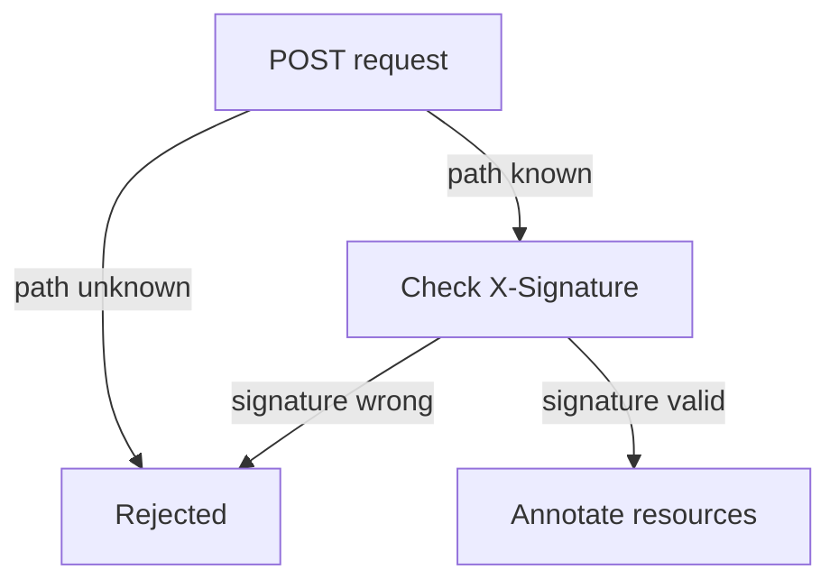

# Sending A Signed Request By Hand

A webhook is only a `POST` request with a header, so you can make one yourself. Doing it once removes the mystery: you see exactly which bytes get signed, you see the controller accept a good request and reject a bad one, and you can test a Receiver without a Git server. This part builds a `generic-hmac` Receiver and sends it a correct and an incorrect request.

## Create a generic-hmac Receiver

The token Secret from before is reused. Save this as `receiver-hmac.yaml`:

<!-- astrona:playground:renew -->

```yaml
apiVersion: notification.toolkit.fluxcd.io/v1
kind: Receiver
metadata:
  name: hmac-receiver
  namespace: flux-system
spec:
  type: generic-hmac
  secretRef:
    name: receiver-token
  resources:
    - apiVersion: source.toolkit.fluxcd.io/v1
      kind: GitRepository
      name: fleet
```

Apply it and read the path:

```sh
kubectl apply -f receiver-hmac.yaml
HOOK_PATH="$(kubectl -n flux-system get receiver hmac-receiver -o jsonpath='{.status.webhookPath}')"
echo "$HOOK_PATH"
```

Start a port-forward to the Service in a second terminal, so your machine can reach notification-controller:

```sh
kubectl -n flux-system port-forward svc/webhook-receiver 9292:80
```

## Compute the signature

The signature is the HMAC-SHA256 of the exact bytes of the body, made with the token, written in hexadecimal. Read the token back from the Secret and sign a small body:

```sh
TOKEN="$(kubectl -n flux-system get secret receiver-token -o jsonpath='{.data.token}' | base64 -d)"
BODY='{"event":"manual-test"}'
SIGNATURE="$(printf '%s' "$BODY" | openssl dgst -sha256 -hmac "$TOKEN" | sed 's/^.* //')"
echo "$SIGNATURE"
```

`printf '%s'` writes the body without a trailing newline, because a newline would change the bytes and so the hash. `openssl dgst` prints the hash with a label in front, and `sed` removes the label.

## Send a valid and an invalid request

Record the time of the last request on the `GitRepository`, then send the signed request:

```sh
kubectl -n flux-system get gitrepository fleet -o jsonpath='{.metadata.annotations.reconcile\.fluxcd\.io/requestedAt}{"\n"}'
curl -i -X POST -H "X-Signature: sha256=$SIGNATURE" --data "$BODY" "http://127.0.0.1:9292$HOOK_PATH"
```

The response is a success status, and the annotation now holds a new time. The Receiver accepted the request and asked source-controller to reconcile.

Now send the same body with a signature that is wrong, by changing one character:

```sh
curl -i -X POST -H "X-Signature: sha256=0000$SIGNATURE" --data "$BODY" "http://127.0.0.1:9292$HOOK_PATH"
```

The response is an error status, and the annotation keeps its old value. The path was right, and the signature was not. Last, send the valid signature to a path with one character changed. The Receiver answers that it does not know the path, which shows that the path alone is also a check.



The diagram shows the two checks a `generic-hmac` request passes, first the path and then the signature.

You can now build a signed request, send it, and see the controller accept or reject it. The module continues with what an accepted request triggers.

## Common pitfalls

> [!WARNING]
> - **Signing a body with a trailing newline.** `echo` adds one, so the bytes differ from what `curl --data` sends. Use `printf '%s'`.
> - **Sending a different body than the one you signed.** The hash covers the exact bytes. Any change breaks it.
> - **Forgetting the algorithm prefix.** The header value is `sha256=` followed by the hex, not the hex alone.
> - **Leaving the port-forward running.** It exposes the Receiver on your machine only while it runs, but stop it when you finish.
