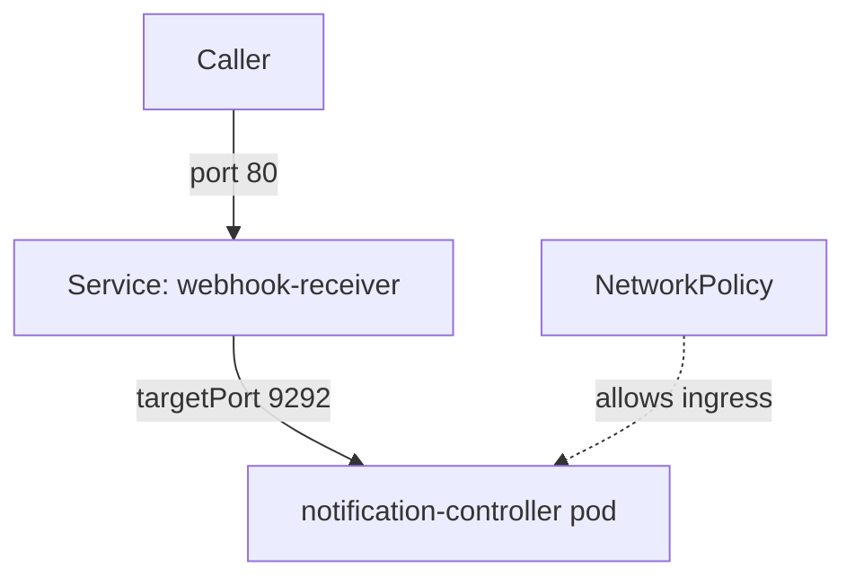

# The Service And The Network Path Inside The Cluster

Before you open anything to the internet, you need to know the path a request takes inside the cluster. The path has three stages: the Service that gives notification-controller an address, the pod that listens on a port, and the NetworkPolicy that decides which sources may connect. When a webhook fails later, you will check these stages one by one, so learn them now while they work.

## The Service and its ports

Flux installs a Service named `webhook-receiver` in `flux-system`. Read it:

<!-- astrona:playground:renew -->

```sh
kubectl -n flux-system get service webhook-receiver -o wide
kubectl -n flux-system get service webhook-receiver -o jsonpath='{.spec.type} {.spec.ports[0].port} {.spec.ports[0].targetPort}{"\n"}'
```

The type is `ClusterIP`, which means the Service has an address only inside the cluster. The Service listens on port `80`, and forwards to the named port `http-webhook` of the notification-controller pod, which is port `9292`. The selector picks the pod by its labels. Check that the Service has an endpoint, which is the address of a ready pod behind it:

```sh
kubectl -n flux-system get endpoints webhook-receiver
```

An empty endpoints list means that no ready pod matches the selector, and no request can succeed.

## Call it from inside the cluster

The `tester` pod has `curl`. Create a Receiver and call it from that pod. Create the token and save this as `receiver-gitea.yaml`:

```sh
kubectl -n flux-system create secret generic receiver-token --from-literal=token="$(head -c 24 /dev/urandom | od -An -tx1 | tr -d ' \n')"
```

```yaml
apiVersion: notification.toolkit.fluxcd.io/v1
kind: Receiver
metadata:
  name: gitea-receiver
  namespace: flux-system
spec:
  type: github
  events:
    - "ping"
    - "push"
  secretRef:
    name: receiver-token
  resources:
    - apiVersion: source.toolkit.fluxcd.io/v1
      kind: GitRepository
      name: fleet
```

Apply it and send a request without a signature from the `tester` pod:

```sh
kubectl apply -f receiver-gitea.yaml
HOOK_PATH="$(kubectl -n flux-system get receiver gitea-receiver -o jsonpath='{.status.webhookPath}')"
kubectl -n gitea exec deploy/tester -- curl -s -o /dev/null -w '%{http_code}\n' -X POST "http://webhook-receiver.flux-system.svc.cluster.local$HOOK_PATH"
```

The request reaches the controller and is rejected, because the `github` type needs a signature. A response code from the Receiver, even an error, proves that the Service, the port and the network path work. A timeout would mean the path is broken before the controller.

## The NetworkPolicy

Flux installs NetworkPolicy objects in `flux-system`. One of them, `allow-webhooks`, selects the notification-controller pod and allows incoming connections to its webhook port from any source. The others limit what the controllers accept otherwise. List them:

```sh
kubectl -n flux-system get networkpolicy
kubectl -n flux-system get networkpolicy allow-webhooks -o yaml
```

If you replace `allow-webhooks` with a stricter policy, you decide which namespaces and pods may call the Receiver. A Git server in the cluster would then need to match the policy, and an ingress controller too. A cluster whose network plugin does not enforce NetworkPolicy ignores these objects, so check that yours does before you rely on them.



The diagram shows the three stages. A request fails at the first one that rejects it, which tells you where to look.

You can now describe the in-cluster path of a webhook and test it from a pod. The next question is how to give the same path an address outside the cluster.

## Common pitfalls

> [!WARNING]
> - **Testing only from your machine with a port-forward.** A port-forward bypasses the Service's policy and the network path that real senders use.
> - **Assuming port 9292 is the Service port.** The Service listens on 80. The pod listens on 9292.
> - **Counting a rejected response as a failure of the path.** A 4xx from the Receiver proves the path works. Read the cause in the next layer.
