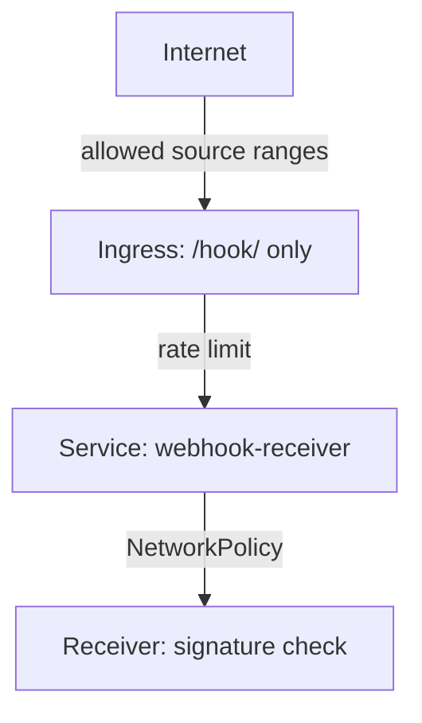

# Limiting Who Can Call It

A public webhook address will be found. Scanners probe paths, and addresses show up in logs, proxies and tickets. The Receiver's secret path and signature make a stranger's request fail, but they cannot stop the stranger from sending it, and each request costs a little work. This part adds layers around the Receiver so that few requests arrive at all.

## Prefer a type that signs

The strongest layer sits in the Receiver itself. Use `github`, `bitbucket`, `generic-hmac` or `nexus` where the sender supports them, so that a request without a valid signature is rejected before it triggers anything. Avoid `generic`, `dockerhub`, `quay` and `acr` on a public address unless another layer protects them, because for those types the path is the only protection.

Use a different token and so a different path for each sender. When a sender is retired or compromised, you rotate one token and nothing else changes.

## Limit the source addresses

GitHub, GitLab and Bitbucket publish the address ranges their webhooks come from. An ingress controller can allow only those ranges. With ingress-nginx, an annotation on the Ingress does this. Save the annotation into the metadata of `ingress-webhook.yaml`:

<!-- astrona:playground:renew -->

```yaml
metadata:
  name: webhook-receiver
  namespace: flux-system
  annotations:
    nginx.ingress.kubernetes.io/whitelist-source-range: "192.0.2.0/24,198.51.100.0/24"
```

The two ranges are documentation examples. Put the real ranges of your Git service in their place, and refresh them when the provider changes them. Other ingress controllers and Gateway API implementations have their own settings for the same purpose. If you cannot list source ranges, for example for a self-hosted server on a changing address, rely on the signature and the rate limit instead.

## Limit the request rate

A flood of valid-looking requests can still make source-controller fetch repeatedly. Most ingress controllers can limit requests per second per client address. A webhook sender makes a few requests per push, so a small limit costs nothing and stops a loop. With ingress-nginx, the annotation `nginx.ingress.kubernetes.io/limit-rps` sets it.

## Keep the in-cluster policy tight

Inside the cluster, replace the open `allow-webhooks` NetworkPolicy with one that allows connections to notification-controller's webhook port only from the namespace of the ingress controller and from the namespace of any in-cluster Git server. Then a compromised pod elsewhere cannot call the Receiver directly. Test the policy by calling the Receiver from a pod in an unrelated namespace and confirming that the connection times out.



The diagram shows the layers a request meets, from the outside to the signature check. Each layer stops a different kind of unwanted request.

You can now name the layers that protect a public Receiver and say what each one stops. When delivery still fails, you need to find which layer drops the request.

## Common pitfalls

> [!WARNING]
> - **Relying on a source list alone.** Ranges change and shared addresses exist. Keep the signature check.
> - **Using one token for many senders.** Rotating it breaks all of them at once.
> - **Writing a NetworkPolicy and not testing it.** A mistake blocks the Git server and nothing reports it. Test from an allowed and a blocked pod.
