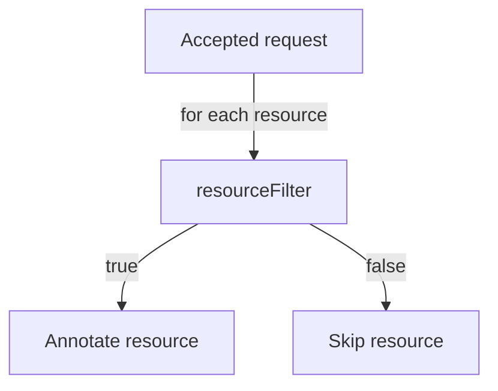

# Registry Types And Filters

A pipeline can send a signed request of its own design, but registries send their own formats, and you cannot change them. The Receiver types for registries exist so that a webhook from Docker Hub, Harbor or Quay works as it is. A newer field, a filter written in the Common Expression Language, lets one Receiver choose which resources to refresh from what the request says. This part covers both.

## What a registry webhook carries

A registry webhook is sent when an image or artifact is pushed. Its body names the repository and the tag. The types differ in how they authenticate the request:

| Type | Registry | Authentication |
| --- | --- | --- |
| `dockerhub` | Docker Hub | The secret path only |
| `quay` | Quay | The secret path only |
| `harbor` | Harbor | The `Authorization` header must equal the token |
| `gcr` | Google Artifact Registry through Pub/Sub | The bearer token of the push subscription |
| `acr` | Azure Container Registry | The secret path only |
| `nexus` | Nexus Repository | An HMAC of the body in `X-Nexus-Webhook-Signature` |

For Harbor, put the token into the webhook's authentication header field, so that the header equals the token. For types that check only the path, limit who can call the address with source address lists and network policies, because the path is the only protection.

## A Receiver does not read the repository name

By default, the registry types do not compare the pushed repository name with your resources. Any accepted request reconciles every resource in the list. With one Receiver per registry, that refreshes sources for repositories that did not change. The cost is small for one source and large for hundreds.

## Select resources with a CEL expression

Recent Flux versions add the field `spec.resourceFilter`. It holds a Common Expression Language (CEL) expression that runs for each resource in the list. The expression sees the request body and the resource, and the resource is reconciled only if the expression is true. Check that your Flux version has the field:

<!-- astrona:playground:renew -->

```sh
kubectl explain receiver.spec.resourceFilter
```

If the command prints a description, the field exists. The Flux documentation lists the variables the expression can use. A typical use is to compare a field of the pushed repository with the name of the resource, so that one Receiver serves many sources and refreshes only the one that matches. Write the expression against the variables the documentation names for your version, and test it with a request before you rely on it.



The diagram shows that the filter runs once for each listed resource after the request passed its type check.

You can now choose the type for a registry and narrow what a request refreshes. The last part deals with many resources and with operating Receivers over time.

## Common pitfalls

> [!WARNING]
> - **Using `dockerhub` on an open address without other limits.** The path is the only check.
> - **Assuming the Receiver matches the repository name.** Without a filter it reconciles every listed resource.
> - **Writing a filter and never sending a request to test it.** An expression that is always false hides the Receiver's effect.
